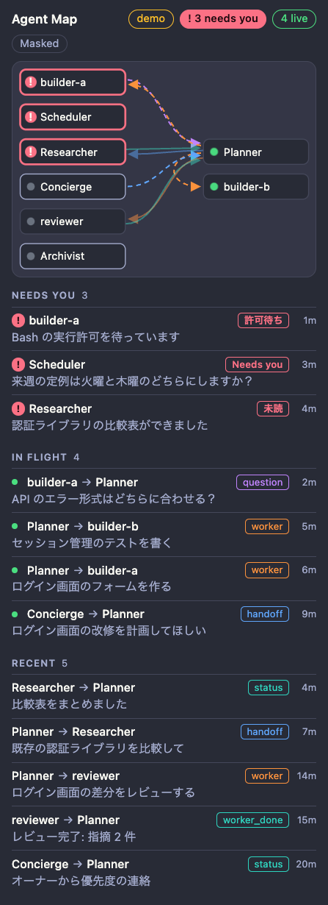
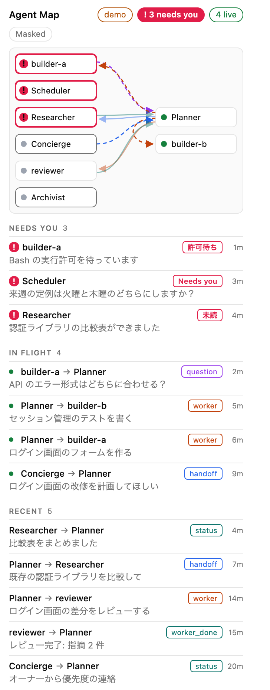

# orca-agent-map

[Orca](https://github.com/stablyai/orca) の右サイドバーに、ボット・エージェント・worker の間の依頼をリアルタイムに描くパネル（Orca プラグイン）。

| ダーク                                    | ライト                                     |
| ----------------------------------------- | ------------------------------------------ |
|  |  |

スクリーンショットはプラグイン内蔵のデモデータ（ダミー）で描いたもの。

## 入れ方

Orca 1.4.246 以降が必要。

```sh
orca plugin install tqer39/orca-agent-map --json
```

このプラグインは worker（Node のプロセス）で `orca` CLI を呼ぶため、初回は承認が要る。上のコマンドは `approval_required` で止まり、許可する内容（`trusted-worker` で動くこと、`settings:own`）と `--approve <fingerprint>` 付きのコマンドを返すので、内容を確かめてからそのコマンドを実行する。

入れたら右サイドバーのアクティビティバーに出る **Agent Map**（activity のアイコン）を開く。

手元の clone から試すとき:

```sh
git clone https://github.com/tqer39/orca-agent-map.git
cd orca-agent-map
orca plugin dev load . --json   # 承認の内容と --approve 付きのコマンドが返る
# 返ってきた承認の内容を確かめてから、そのコマンドを実行する
orca plugin dev load . --json --approve <fingerprint>
orca plugin open local.agent-map --panel agent-map
```

## 見方

- **上部の図**: 左が主に送る側、右が主に受ける側。線は送り元から送り先への依頼で、色は種類（handoff / question / status / worker / escalation）。返事待ちや作業中の依頼は点線が流れる。同じ組の依頼は 1 本にまとめる。
- **ノードの点**: 緑の点滅は作業中、黄は返事待ち、赤は許可待ち、灰は待機中（終わっている）。ボットは動いていなくても待機中のノードとして出る。worker は動いている間と、終わってから 15 分だけ出る。
- **人の対応待ち（NEEDS YOU）**: 赤い枠と「!」の印のノード、ヘッダの「! N needs you」、一覧の一番上の **NEEDS YOU** 欄。理由は文字でも出す（許可待ち / 返事待ち / Needs you / 未読）。枠はゆっくり点滅する（OS で「視差効果を減らす」にしていると点滅しない）。
- **IN FLIGHT**: 返事待ちの handoff / question / escalation と、走っている worker。0 件のときは「いま動いているエージェントはありません」と出す。
- **RECENT**: 最近の依頼と報告（新しい順に 20 件）。
- **N live**: IN FLIGHT の件数。
- **Masked**: 押すと件名と NEEDS YOU の本文を伏せる（画面共有用）。設定に保存され、次に開いたときも続く。
- データを取れなかったときは、最後に取れた状態を残したまま「更新できませんでした」と何が失敗したかを出す。

### 返事待ちの判定

handoff / question / escalation は、次のどれかが来るまで IN FLIGHT に置く。

- `thread_id` がその依頼を指すメッセージ
- `payload.requestId` がその依頼を指すメッセージ
- 依頼の後に、受け手から送り手へ送られたメッセージ

12 時間より古い返事待ちは放置されたものとして IN FLIGHT から外す。

## データの元

Orca の plugin API には orchestration の inbox や worker 一覧を読むメソッドが無いため、プラグインの worker が `orca` CLI を呼んで JSON を読む。パネルが見えている間だけ、設定の間隔（既定 5 秒）で読み直す。

| 表示                                                  | コマンド                                                    | 使う項目                                                                                                                                         |
| ----------------------------------------------------- | ----------------------------------------------------------- | ------------------------------------------------------------------------------------------------------------------------------------------------ |
| 依頼の線、IN FLIGHT、RECENT                           | `orca orchestration inbox --json --full --limit 100`        | `from_handle` / `to_handle` / `type` / `subject` / `created_at` / `thread_id` / `payload`                                                        |
| 走っている worker                                     | `orca orchestration worker-list --json`                     | `workspace` / `outcome` / `taskId`                                                                                                               |
| 名前、状態、worker の依頼元、許可待ち・返事待ち・未読 | `orca worktree ps --json`                                   | `worktreeId` / `bot` / `agents[].orcaSessionId` / `paneKey` / `parentPaneKey` / `activity.status` / `activity.unread` / `toolName` / `taskTitle` |
| ボットのノード                                        | `orca bot list --json`                                      | `name`                                                                                                                                           |
| ボットの Needs you の Item                            | `orca bot item list --bot <名前> --status needs-you --json` | `title` / `question.text` / `updatedAt`                                                                                                          |

- inbox のセッション ID は `worktree ps` の `orcaSessionId` と突き合わせて名前にする。ボットの worktree のセッション（チャット）は、ボットごとに 1 つのノードにまとめる。
- worker の依頼元は、worker のエージェントの `parentPaneKey` が指すペインのエージェント。
- `ps` に居ない送り手は、`payload.botRequest.from` にボット名があればそれを、無ければセッション ID の先頭 6 文字を出す。
- ボットの一覧と Item はボットの数だけ CLI を呼ぶので、15 秒のあいだ使い回す。
- `orca` は PATH から探し、見つからなければ macOS の `/Applications/Orca.app/Contents/Resources/bin/orca` を使う。設定の「orca CLI のパス」で変えられる。

### 取れないもの・できないこと

- Orca の起動時にパネルを開いた状態にする設定は、プラグインの manifest と API に無い。パネルを開く操作（`orca plugin open`）はできるが、起動時に自動で開く仕組みは無い。
- 依頼の本文はパネルに出さない（件名だけ）。

## 設定

Orca の Settings → Plugins → Agent Map で変えられる。

| 設定                   | 既定 | 内容                                    |
| ---------------------- | ---- | --------------------------------------- |
| 更新間隔（秒）         | 5    | 2〜60 秒                                |
| 件名を伏せる（Masked） | オフ | パネルの Masked と同じ                  |
| orca CLI のパス        | 空   | 空なら PATH の `orca`                   |
| デモデータを表示       | オフ | Orca の情報の代わりにダミーデータを描く |

## 開発

ツールは [mise](https://mise.jdx.dev/) で揃える（[dev-standards](https://github.com/tqer39/dev-standards) の構成）。

```sh
mise run bootstrap      # 依存を入れる
mise run lint           # Biome
mise run format:check
mise run test           # orca plugin validate / test / check
mise run build          # orca plugin types（.orca/types を作る）と tsc の型チェック
```

`scripts/orca.sh` は PATH の `orca` を使う。無い Linux（CI など）では、公式リリースの orca-server を `.cache/orca` に取ってきて、SHA-256 を確かめてから使う。

- `src/model.ts`: CLI の JSON を描く形にする純粋関数
- `src/worker.ts`: CLI を呼ぶ worker
- `src/demo.ts`: デモ表示とテストのダミーデータ
- `panel/`: HTML パネル（`view.ts` は DOM に触らない描画関数）

テストやスクリーンショットには実在のボット名・依頼文・セッション ID を入れず、`src/demo.ts` のダミーデータを使う。

## ライセンス

[MIT](LICENSE)
